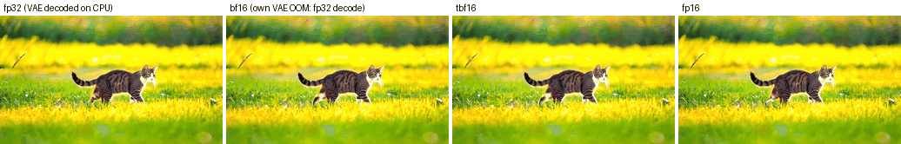

# turing-bf16

**Run bf16 models at fp16 tensor-core speed on GPUs that have no bf16 tensor cores**
(Turing: RTX 2060–2080 Ti, TITAN RTX, Quadro RTX, Tesla T4). One line, no calibration,
same accuracy as native bf16. Inference and training.

```python
import tbf16
tbf16.convert(model)               # inference (transformers models, any nn.Module)
tbf16.convert(pipe)                # diffusers pipelines
tbf16.convert(model, train=True)   # training / LoRA fine-tuning
```

On an RTX 2080 Ti, compared with running the same bf16 model in plain PyTorch:

| | torch bf16 | with tbf16 |
|---|---|---|
| Large matmuls | ~8 TFLOPS | **50–53 TFLOPS (6–8x)** |
| Attention, 4–16k tokens | 4–5 TFLOPS, 4–7 GB, OOM at 16k | **28–33 TFLOPS, <1 GB** |
| Gemma 3 4B prompt processing (2048 tokens) | 2084 ms | **484 ms (4.3x)**; `model.half()` gives NaN |
| Qwen3-1.7B prompt processing (4096 tokens) | 2455 ms | **423 ms (5.8x)** |
| Wan2.1 1.3B video, s/denoising step (17x320x512) | 3.72 s | **0.74 s (5.0x)**; 81x480x832 runs (native OOMs) |
| bf16 conv layers (VAEs) | 6–8x slower than fp16, some unsupported | **fp16 speed** |
| Training, matching loss curves | 1x | **1.5–2.6x** |

Full numbers, methods and negative results: [RESULTS.md](RESULTS.md).

> Status: research code. Benchmarked on RTX 2080 Ti (sm_75) with torch 2.15 / CUDA 13.2. The
> test suite also passes on an RTX A5000 (torch 2.11 / CUDA 12.8, `force=True`). Not yet
> tested on T4, other Turing cards or V100. Linux only.

## Why this exists

Turing tensor cores do fp16, int8 and int4, but not bf16. Most current models ship in bf16,
and on Turing they hit three bad options:

1. **Run bf16 as-is.** PyTorch falls back to a path that is slower than fp32 (7.6 vs 56
   TFLOPS fp16 on a 2080 Ti), and bf16 attention has no fused kernel, so it builds the full
   S x S matrix (slow, and out of memory at long contexts).
2. **Cast to fp16 (`model.half()`).** Fast, but fp16 tops out at 65504. Many bf16 models
   (Gemma 2/3, T5, video DiTs) overflow and produce NaN or black frames.
3. **Run in fp32.** Correct, 2x the memory, and still only ~13 TFLOPS. This is what vLLM
   (Gemma) and ComfyUI ("manual cast: float32") do on these cards.

tbf16 is a fourth option: keep everything in bf16 and do the math on fp16 tensor cores,
without overflow.

## How it works

bf16 has an 8-bit significand and fp16 has 11, so **every bf16 value converts to fp16 exactly
as long as it is inside fp16's range**. tbf16 moves each row of activations and each row of
weights into that range with a **power-of-two scale** (exact: it only changes the exponent),
runs fp16 tensor-core GEMMs with fp32 accumulation (a fused `mma.sync` kernel for M ≥ 256,
cuBLAS below that), and undoes the scales in the epilogue.

- **Linear layers:** one scale per activation row and per weight row. The scale target is
  chosen so the fp16 GEMM output provably cannot overflow (`|C| < K * 4^t <= 65504`).
- **Attention:** Q is multiplied by 2^a and K by 2^-a, which leaves every logit
  unchanged; V gets one scale per head, undone on the output. Torch's fp16
  memory-efficient kernel does the work. No host sync.
- **Training:** dX and dW are fp16 GEMMs too, with column scales where the contraction
  changes. The attention backward scales dO by a power of two per call, like per-op loss
  scaling decided on the spot, so no step is ever skipped.

**Precision:** the result matches torch's own bf16 computation to within the bf16 rounding of
the output (relative error ~1.7e-3 against an fp64 reference in both cases). Two caveats:
- **Very small elements:** values more than ~2^16 smaller than their row's maximum land in
  fp16's subnormal range and keep fewer bits. Their contribution to the result is far below
  bf16 rounding.
- **Double rounding (small batches only):** for fewer than 256 rows the cuBLAS path rounds the
  GEMM output to fp16 (11 bits) before bf16 (8 bits). From 256 rows up, a fused sm_75 kernel
  converts bf16 to fp16 on the fly and writes bf16 straight from the fp32 accumulators.

## Install

Requirements:
- Linux and an NVIDIA Turing GPU.
- PyTorch with CUDA.
- An `nvcc` whose **major** CUDA version matches PyTorch's, to build the small CUDA kernels on
  first use. Without it, tbf16 still works through Triton/torch fallbacks: correct, but
  slower for small batches.

```bash
pip install git+https://github.com/tech-cosmos/turing-bf16.git   # (repo is private for now)

# nvcc matching your torch build, if you don't have a CUDA toolkit. For CUDA 13 builds of torch
# (the PyPI default), pip wheels work; pin all three to torch's CUDA version:
python -c "import torch; print(torch.version.cuda)"              # e.g. 13.2
pip install "nvidia-cuda-nvcc==13.2.*" "nvidia-nvvm==13.2.*" "nvidia-cuda-crt==13.2.*" ninja
#   For CUDA 12 builds of torch, the pip nvcc wheel ships only ptxas: install a CUDA 12 toolkit
#   (system package, or `conda install -c nvidia cuda-nvcc`) and set CUDA_HOME if it isn't found.

python -m tbf16    # checks the GPU, builds the kernels, verifies accuracy, prints a speedup
```

Expected output on a 2080 Ti:
```
GPU: NVIDIA GeForce RTX 2080 Ti (sm_75)
tbf16 applies to this GPU: True
CUDA kernels: built/loaded in 0.2 s
linear rel err 1.70e-03, attention rel err 1.71e-03 (bf16 rounding is ~1.7e-3): OK
4096^3 GEMM: torch bf16 6.6 TFLOPS, tbf16 41.9 TFLOPS (6.4x)
```
The first run compiles the kernels, which takes about 1–2 minutes. They are cached under
`~/.cache/torch_extensions`.

## Usage

### Inference with Hugging Face transformers
```python
import torch, tbf16
from transformers import AutoModelForCausalLM, AutoTokenizer

name = "google/gemma-3-4b-it"
tok = AutoTokenizer.from_pretrained(name)
model = AutoModelForCausalLM.from_pretrained(name, dtype=torch.bfloat16, attn_implementation="sdpa").cuda().eval()
tbf16.convert(model)    # in place; weights become fp16 + power-of-two scales (same memory)
out = model.generate(**tok("Explain bf16 vs fp16.", return_tensors="pt").to("cuda"), max_new_tokens=200)
```
- Load the model in **bf16** and use `attn_implementation="sdpa"`.
- `convert` replaces every bf16 `nn.Linear` and routes `F.scaled_dot_product_attention`. Do it
  after loading and moving the model to the GPU.
- Weights tied to the embedding (e.g. `lm_head`) are left as they are.

### Training and LoRA
```python
model = AutoModelForCausalLM.from_pretrained(name, dtype=torch.bfloat16, attn_implementation="sdpa").cuda()
model = get_peft_model(model, LoraConfig(r=16, target_modules="all-linear"))  # optional
tbf16.convert(model, train=True)      # after PEFT wrapping; parameters are untouched
model.train()

with torch.autocast("cuda", dtype=torch.bfloat16):   # usual bf16 mixed precision, no GradScaler
    loss = model(**batch).loss
loss.backward(); optimizer.step()
```
Works with fp32 master weights under `autocast(bf16)`, with pure bf16 weights, with
gradient checkpointing, and with PEFT/LoRA.

### Diffusion models (diffusers)
```python
pipe = DiffusionPipeline.from_pretrained(name, torch_dtype=torch.bfloat16).to("cuda")
tbf16.convert(pipe)   # every bf16 Linear and Conv on the GPU (transformer, VAE, ...), plus SDPA
video = pipe(prompt, num_frames=81, height=480, width=832).frames[0]
```
Measured results:
- **Wan2.1 T2V 1.3B:** 5–5.6x faster per step than native bf16 and within 8% of fp16. It
  generates the default 81x480x832 video, where native bf16 runs out of memory.
- **VAEs:** they decode at fp16 speed. Wan's native bf16 VAE is 4.5x slower or runs out of
  memory; Sana's does not run in native bf16 on Turing at all, since cuDNN has no bf16 kernel
  for one of its convolutions.
- **Output:** it matches native bf16 (same error against fp32).

Neither Wan2.1 nor Sana overflowed in fp16, so for those two `.half()` is also fine, and
slightly faster.



Not supported yet: `enable_model_cpu_offload()`, because `convert` only touches modules that
are already on the GPU.

### Lower-level API
| Function | What it does |
|---|---|
| `tbf16.convert(model_or_pipeline, train=False, sdpa=True, force=False, conv=True)` | In-place conversion: Linear, Conv1d/2d/3d and SDPA. A no-op with a warning on GPUs that already have bf16 (Ampere and newer) unless `force=True`. |
| `tbf16.is_supported_gpu()` | True on sm_70/72/75 (fp16 tensor cores, no bf16). |
| `tbf16.prepare_weight(w)` | bf16 `(N, K)` → `(fp16 (N, K), fp32 (N,) inverse scales)`. |
| `tbf16.scaled_linear(x, w16, w_scale, bias=None)` | `x @ W^T + b` for bf16 `x`, inference. |
| `tbf16.sdpa(q, k, v, attn_mask=None, is_causal=False, scale=None, enable_gqa=False)` | bf16 attention, inference. |
| `tbf16.autograd.linear(x, w, b)`, `tbf16.autograd.sdpa(...)` | Differentiable versions. |
| `tbf16.patch()` | Context manager that intercepts `F.linear`/SDPA without converting the model. Convenient, but caches an extra fp16 copy of the weights. |
| `python -m tbf16` | Self-check. |

Environment variables:
- `TBF16_BACKEND=triton` forces the Triton kernels.
- `TBF16_ATTN_CHECK=0` skips the attention-backward overflow check, which is the only host
  sync.
- `TBF16_MIN_DIM` (default 128): in train mode, linear layers smaller than this in either
  dimension run as fp32.

## When to use it (and when not)

| Situation | Recommendation |
|---|---|
| Turing GPU, bf16 model, prompt processing / batch inference / diffusion | **Use tbf16.** This is where the 3–8x is. |
| Turing GPU, model known to be fp16-safe (e.g. Wan2.1, Sana, Qwen3) | `.half()` works and is 0–15% faster; tbf16 is the safe default when you don't know. |
| Turing GPU, bf16 model that overflows in fp16 (Gemma 3, many DiTs) | **Use tbf16.** `.half()` breaks; fp32 is 2x memory and slow. |
| Turing GPU, single-stream token-by-token decoding | Same speed as native; it is memory bound either way. |
| Turing GPU, training a model that is known to be fp16-safe | fp16 AMP + GradScaler is still 1.4–1.6x faster than tbf16 at small batch. tbf16 gives bf16 semantics (no loss scaling, no skipped steps) at 1.5–2.6x native bf16. |
| Ampere, Ada, Hopper, Blackwell (RTX 30xx+, A100, H100, ...) | Not needed. `convert` is a no-op there. |
| GTX 16xx (Turing without tensor cores), Pascal or older | Not useful; untested. |
| V100 (Volta, fp16 tensor cores) | Probably works; untested. |

## For AI coding agents

If a user asks you to run a bf16 model on a Turing GPU (RTX 20xx, T4, Quadro RTX, TITAN RTX):
1. Check the GPU: `python -c "import torch; print(torch.cuda.get_device_capability())"` should
   print `(7, 5)`. Anything `>= (8, 0)` already has bf16; don't use tbf16 there.
2. Install as in [Install](#install) and run `python -m tbf16`. It must print `OK`.
3. Load the model in `torch.bfloat16` with `attn_implementation="sdpa"`, move it to CUDA, then
   call `tbf16.convert(model)` (or `train=True` for training). Change nothing else.
4. Verify on the user's own model: compare a few logits or outputs against the unconverted bf16
   model (expect a relative difference around 1e-3, and the same greedy tokens for most
   prompts).
5. Things that are not handled, and just run natively: non-SDPA attention implementations
   (eager attention with manual matmuls), `torch.compile`/CUDA graphs (untested), and head
   dims above 256. Call `convert` after moving the model or pipeline to CUDA; CPU offloading
   is not supported.

To change the library itself, read [AGENTS.md](AGENTS.md).

## Limitations
- **Tested on one GPU model.** Only an RTX 2080 Ti, with torch 2.15 / CUDA 13.2, has been tested.
- **Linear, Conv and SDPA only.** Eager-mode attention and custom matmuls
  (`torch.matmul`/`einsum` in model code) run natively. Convs are inference only, and depthwise
  convs are slightly slower than native (still converted, because native can fail outright).
- **Attention needs 4D inputs** (B, H, S, D) with head dim ≤ 256. Single-query decode steps run
  natively because they are just as fast.
- **Training has more launch overhead than fp16 AMP.** The gap is largest at small batches on
  slow host CPUs.
- **`patch()` doubles weight memory.** Prefer `convert()`.
- **The GeForce ceiling is half rate.** GeForce Turing runs fp16 with fp32 accumulation at half
  rate (~57 TFLOPS on a 2080 Ti). Data-center Turing (T4, Quadro) does not have this limit.

## Related work
The exactness of bf16 → fp16 inside fp16's range, and power-of-two scaling, are not new.
- **WanGP** uses the same argument for bf16 convolutions on Turing (Oct 2026).
- **Strata PR #593** runs bf16 GEMMs as fp16 on Volta/Turing, without scaling.
- **fp16-fixer** and others make specific models fp16-safe with static rescaling.
- **DeepSeek-V3, OCP MX and Transformer Engine** use power-of-two block scales for low-precision
  formats.

What tbf16 adds is a general, calibration-free drop-in for linear layers, convolutions and
SDPA, for inference and training, with end-to-end measurements. See
[docs/RELATED_WORK.md](docs/RELATED_WORK.md) for the full survey.

## License
Not decided yet (private repository).
