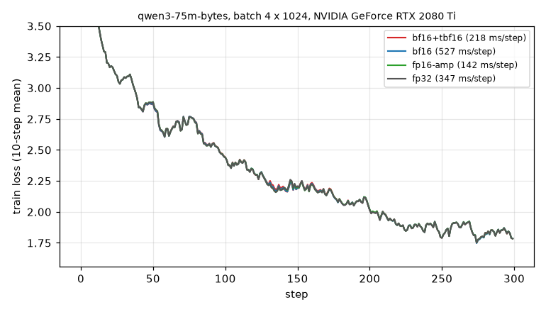
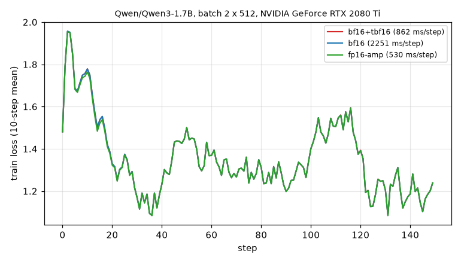
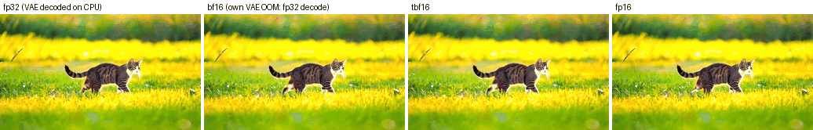
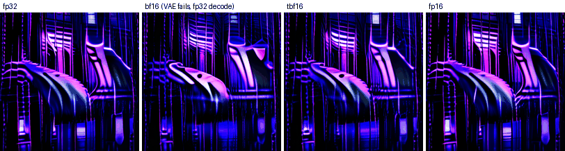

# Results

All numbers on one NVIDIA GeForce RTX 2080 Ti (Turing, sm_75, 11 GB), torch 2.15 + CUDA 13.2,
on a lab server with 8x RTX 2080 Ti. Timings are steady state (warm-up excluded).

## Why: bf16 on Turing is slower than fp32

`bench/baseline.py`, dense `a @ b`, TFLOPS:

| (M, K, N) | fp32 | fp16 (tensor cores) | bf16 |
|---|---|---|---|
| 4096, 4096, 4096 | 12.2 | 56.9 | 7.8 |
| 8192, 3072, 12288 | 13.4 | 55.4 | 7.6 |
| 16384, 5120, 5120 | 13.3 | 55.8 | 7.6 |

bf16 also loses its GEMV path at M = 2-32 (~4x slower than M = 1). Attention is worse:
torch has no fused bf16 attention kernel for sm_75, so SDPA runs the math path, which
materializes the S x S matrix (5 TFLOPS, 4-7 GB at 4-8k tokens, OOM at 16k).

## How

bf16 has 8 significand bits and fp16 has 11, so a bf16 value converts to fp16 exactly
if it is inside fp16's range. Each row (activations) and each output channel (weights)
gets an exact power-of-two scale that puts its max in [0.5, 1), the GEMM runs on fp16
tensor cores with fp32 accumulation, and the scales are undone in the epilogue. For
attention, Q is scaled by 2^a and K by 2^-a (logits unchanged) and V per head.

## Linear (`bench/linear.py --cool`)

TFLOPS, median of 3 runs, GPU cooled to 50 C before each measurement (see notes). "cuBLAS
path" = quantize + cuBLAS fp16 + epilogue, "fused" = one GEMM kernel (below), "tbf16" = the
default, fused from M = 256 rows up.

| (M, K, N) | torch bf16 | tbf16 cuBLAS path | tbf16 fused | tbf16 | speedup | fp16 ceiling |
|---|---|---|---|---|---|---|
| 4096, 4096, 4096 | 7.9 | 50.0 | 52.3 | 52.1 | 6.6x | 55.3 |
| 8192, 3072, 3072 | 7.9 | 48.9 | 50.5 | 50.8 | 6.4x | 54.3 |
| 8192, 3072, 12288 | 7.8 | 52.2 | 52.7 | 52.7 | 6.7x | 56.0 |
| 8192, 12288, 3072 | 7.8 | 50.5 | 52.2 | 52.1 | 6.6x | 55.3 |
| 16384, 5120, 5120 | 7.8 | 52.7 | 53.8 | 53.7 | 6.9x | 56.7 |
| 32760, 5120, 13824 | 6.2 | 53.0 | 54.0 | 53.8 | 8.7x | 54.3 |
| 512, 4096, 4096 | 7.7 | 50.8 | 53.4 | 53.2 | 7.0x | 55.5 |
| 64, 4096, 11008 | 6.9 | 29.7 | 18.6 | 30.7 | 4.4x | 29.5 |
| 1, 4096, 4096 | 0.46 | 0.47 | - | 0.47 | ~1x (memory bound) | 0.42 |

### Fused GEMM (`tbf16/csrc/gemm_sm75.cu`)

A pre-pass reads x once and writes each row's power-of-two scale (M floats). The GEMM loads
bf16 x tiles and fp16 W tiles with 16-byte loads into registers, converts x to fp16 with the
row scale on the way to shared memory (bit-identical to `quantize_rows`), and runs
`mma.m16n8k8` (fp32 accumulate) from `ldmatrix` fragments. No cp.async on sm_75, so it is
register-staged double buffering: two swizzled smem stages, one barrier per 32-wide k-tile,
next tile's loads issued a full k-tile before use. The epilogue applies `acc * sa * sb + bias`
in fp32 and writes bf16 once; no fp16 C, so its error is slightly lower than the cuBLAS path's
(1.65e-3 vs 1.70e-3 at 4096x3072x3072). Tiles: 128x256 (8 warps, 64x64 warp tiles) or 128x128
(4 warps, 2 blocks/SM), picked by wave count.

It is 1-5% faster than the cuBLAS path from M = 256 up (M sweep over LLM shapes: 1.03-1.66x,
the larger gains where cuBLAS's own heuristics dip at M = 256-1024) and slower below M = 128
(0.4-0.8x at M = 16-64: too few tiles, and cuBLAS uses sliced-K kernels there). It stays
3-6% under cuBLAS fp16 itself. Where that goes, from ablations at 16384x5120x5120:

| | TFLOPS |
|---|---|
| fused | 54.5 |
| without the bf16 -> fp16 conversion | +0.5 |
| without the row-scale pre-pass (0.30 ms, at DRAM bandwidth) | +1.0 (est.) |
| all CTAs load the same tiles (L2 hits only) | +2.0 |
| no global loads at all (constant operands) | 63 (also less power) |
| cuBLAS fp16 | 58.5 |

So the bf16 handling is nearly free; what is left is DRAM latency on the one-tile-deep
register pipeline and the extra read of x.

## Attention (`tests/test_attention.py`)

Forward, with the fused per-head amax and scale-cast kernels:

| (B, H, S, D) | torch bf16 | tbf16 | fp16 ceiling |
|---|---|---|---|
| 1, 24, 4096, 128 | 5.1 TFLOPS, 3.9 GB | 30.6 TFLOPS, 0.5 GB | 31.4 |
| 1, 12, 8192, 128 | 4.1 TFLOPS, 7.3 GB | 31.8 TFLOPS, 0.5 GB | 32.4 |
| 1, 24, 16384, 64 | OOM | 33.0 TFLOPS, 0.7 GB | 33.2 |
| 4, 32, 2048, 128 | 5.0 TFLOPS, 5.4 GB | 28.4 TFLOPS, 0.8 GB | 29.5 |

Forward + backward, causal (`tests/test_autograd.py`):

| (H, S, D) | torch bf16 | tbf16 |
|---|---|---|
| 16, 2048, 128 | 17.3 ms, 1.78 GB | 5.5 ms, 0.82 GB (3.2x) |
| 16, 4096, 64 | 52.6 ms, 4.78 GB | 7.6 ms, 0.82 GB (6.9x) |

## Accuracy

Relative error vs an fp64 reference from the same bf16 inputs (`tests/test_accuracy.py`):

| case | torch bf16 | naive `.half()` | tbf16 |
|---|---|---|---|
| gaussian | 1.66e-3 | 2.1e-4 | 1.70e-3 |
| outlier tokens x3e4 | 1.65e-3 | NaN/inf | 1.69e-3 |
| all x1e6 | 1.66e-3 | NaN/inf | 1.70e-3 |
| all x1e-8 | 1.66e-3 | 1.0 (underflow) | 1.70e-3 |

The error is the bf16 rounding of the output; tbf16 adds no measurable error of its own.

## Unmodified Hugging Face models (`bench/e2e_llm.py`)

`tbf16.convert(model)`, single 2080 Ti, prefill = one forward over the prompt.

**Gemma 3 4B** (`unsloth/gemma-3-4b-it`), the case where fp16 breaks:

| | prefill 512 | prefill 2048 | prefill 4096 | decode | KL vs fp32 (top-1 agree) |
|---|---|---|---|---|---|
| `model.half()` | | | | | NaN/inf logits |
| native bf16 | 478 ms | 2084 ms | OOM | 11.5 tok/s | 4.7e-4 (99.80%) |
| tbf16 | 144 ms | 484 ms | 1120 ms | 12.1 tok/s | 4.0e-4 (99.51%) |

Greedy generation identical to native bf16 over 128 tokens.

**Qwen3-1.7B**:

| | prefill 512 | 2048 | 4096 | 8192 | decode | peak @4096 |
|---|---|---|---|---|---|---|
| native bf16 | 214 ms | 1002 ms | 2455 ms | OOM | 17.9 tok/s | 6.61 GB |
| tbf16 | 87 ms | 202 ms | 423 ms | 982 ms | 18.7 tok/s | 4.30 GB |

**Gemma 3 1B**: prefill 1.3x / 3.1x / 3.3x / 4.0x at 512 / 2k / 4k / 8k tokens, decode
15.3 vs 14.9 tok/s.

KL vs fp32 for tbf16 is within run-to-run spread of native bf16 on all three models.

## Training (`bench/train_llm.py`, `tests/test_autograd.py`)

`tbf16.convert(model, train=True)`. Gradients (dX, dW, db, dQ, dK, dV, with GQA and
bool/float masks) match torch's bf16 autograd against an fp64 reference, including
gradients scaled by 1e-12 (fp16 would flush them to zero) and by 1e8. Linear fwd+bwd runs
at 48-50 TFLOPS against torch bf16's 8 (6.0-6.4x).

Recipes, same init and same batches, two runs at a time on the 2080 Tis
(raw data: `results/train_final.jsonl`):

- **bf16**: fp32 master weights + `torch.autocast(bf16)`, the usual bf16 mixed precision.
- **bf16+tbf16**: the same, after `tbf16.convert(model, train=True)`.
- **fp16-amp**: fp32 master + `autocast(fp16)` + `GradScaler`, the usual Turing recipe.

| task | bf16 | bf16+tbf16 | fp16-amp | fp32 | eval loss (bf16 / tbf16 / fp16) |
|---|---|---|---|---|---|
| 75M byte-level LM from scratch, 4 x 1024 tokens | 527 ms, 6.16 GB | 218 ms (2.4x), 3.35 GB | 142 ms, 3.27 GB | 347 ms | 1.8183 / 1.8167 / 1.8168 |
| LoRA r=16 all-linear, Qwen3-1.7B, 2 x 512, grad ckpt | 2251 ms | 862 ms (2.6x) | 530 ms | | 1.4524 / 1.4528 / 1.4523 |
| LoRA r=16 all-linear, Gemma 3 1B, 2 x 512, grad ckpt | 1323 ms | 868 ms (1.5x) | 639 ms, 2 skipped steps | | 1.7221 / 1.7223 / 1.7216 |

Honest reading: tbf16 gives bf16 training semantics (no loss scaling, no skipped steps, no
overflow) at 1.5-2.6x the speed of native bf16, with matching loss curves. When a model
trains fine in fp16 (both models above do at this scale), fp16 AMP is still 1.4-1.6x faster.
The gap is mostly host overhead: at these small batches the step is CPU bound on our lab server's
2.2 GHz Xeons (LoRA: 970 ms wall vs 563 ms of GPU kernels for tbf16, 551 vs 392 for fp16),
and tbf16 launches more kernels per layer. Larger batches shrink the gap.

What made the difference while building this:
- Attention backward must keep its tensors in `save_for_backward` (calling torch's
  efficient-attention ops directly). An earlier version kept an inner autograd graph on
  `ctx`, which activation checkpointing could not drop: ~0.7 GB leaked per step and each
  layer was recomputed twice (1118 -> 862 ms/step once fixed).
- Q/K/V and gate/up share one quantized copy of their input (3x/2x less memory for those
  saved activations).
- LoRA adapters (rank 16) are skinny GEMMs where torch's bf16 path is ~20x slower than it
  should be (`magma_sgemmEx`, ~115 ms/step). They now run as fp32 SGEMM.
- Caching frozen base weights in fp16 saved only ~7% for +3.2 GB, so it was dropped.

## Convolutions (`bench/conv.py`)

cuDNN has no fast bf16 convolution on sm_75 either. `tbf16/conv.py` uses the same trick as
the linear layers: a pow2 scale per output channel for the weight, one per sample for the
input, an fp16 cuDNN conv with fp32 accumulation, and one fused multiply-add back to bf16.
1x1 convs go through `scaled_linear`. Time in ms; error vs fp32 conv of the same bf16 inputs.

| conv (input) | bf16 | fp16 | fp32 | tbf16 | rel err tbf16 / bf16 |
|---|---|---|---|---|---|
| 2d 3x3 512ch, 128^2 (VAE) | 13.2 | 1.65 | 3.88 | 1.86 | 1.68e-3 / 1.66e-3 |
| 2d 3x3 256ch, 256^2 (VAE) | 11.0 | 1.92 | 4.03 | 2.27 | 1.67e-3 / 1.66e-3 |
| 2d 3x3 128ch, 512^2 (VAE) | 11.9 | 2.38 | 4.56 | 3.02 | 1.68e-3 / 1.66e-3 |
| 2d 1x1 2240->11200, 2x32^2 (Sana FFN) | 13.2 | 2.02 | 8.74 | 2.14 | 1.68e-3 / 1.66e-3 |
| 2d depthwise 3x3 11200ch, 2x32^2 (Sana FFN) | 0.62 | 0.42 | 0.60 | 0.97 | 1.69e-3 / 1.66e-3 |
| 3d 3x3x3 384ch, 6x60x104 (Wan VAE) | 41.3 | 5.73 | 24.2 | 6.03 | 1.68e-3 / 1.66e-3 |
| 3d 3x3x3 192ch, 6x240x416 (Wan VAE) | OOM | 26.1 | 138 | 39.7 | 1.67e-3 / - |
| 3d 3x3x3 96ch, 6x480x832 (Wan VAE) | OOM | 39.6 | 193 | 48.0 | 1.67e-3 / - |

bf16 convs are 6-8x slower than fp16, large bf16 Conv3d OOMs (5.8 GB requested at 96ch
6x480x832), and some bf16 convs have no cuDNN engine at all: Sana's DC-AE VAE fails with
"GET was unable to find an engine" on a 5x5 depthwise conv over a channels-last input.
`tests/test_conv.py` checks 1d/2d/3d, groups, strides, padding modes, channels-last,
subclasses with their own `forward` (Wan's causal conv), and inputs that overflow fp16.
Depthwise convs are memory bound and get slower (0.97 vs 0.62 ms). They are still
converted because the native bf16 path can fail outright.

## Diffusion models (`bench/e2e_diffusion.py`)

diffusers 0.42.1, unmodified pipelines, `tbf16.convert(pipe)` (transformer and VAE). Same
prompt, seed and initial noise for every variant, 20 steps with CFG. The prompt is encoded
once and cached, so the text encoder never shares the GPU (UMT5-XXL runs on the CPU).
s/step is the median step after a warm-up step, decode time is after a warm-up decode,
and peak memory is `max_memory_allocated`. `fp16` loads the pipeline with
`torch_dtype=float16` (diffusers keeps its fp32 modules in fp32). The fp32 reference runs
on a second 2080 Ti, and its timings varied by up to 1.5x between runs.

**Wan2.1-T2V-1.3B** (`Wan-AI/Wan2.1-T2V-1.3B-Diffusers`, CFG 5 = two transformer passes per step):

| frames x H x W (tokens) | native bf16 | tbf16 | fp16 | fp32 | tbf16 vs native |
|---|---|---|---|---|---|
| 17x320x512 (3,200) | 3.72 s/step | 0.74 | 0.79 | 3.17 | 5.0x |
| 17x480x832 (7,800) | 15.2 | 2.71 | 2.51 | 10.9 | 5.6x |
| 33x480x832 (14,040) | OOM | 6.58 | 6.08 | 22.0 | native OOM |
| 81x480x832 (32,760, the default) | OOM | 28.9 | 27.9 | not run | native OOM |

Total for 20 steps + VAE decode, and peak memory:

| | native bf16 | tbf16 | fp16 | fp32 |
|---|---|---|---|---|
| 17x320x512 | 72.8 + 5.9 s, 7.5 GB | 15.2 + 1.3 s, 4.8 GB | 16.0 + 1.3 s, 4.6 GB | 60.5 + 4.4 s, 8.8 GB |
| 17x480x832 | 304 s + VAE OOM, 9.3 GB | 54.1 + 3.4 s, 7.6 GB | 50.4 + 3.2 s, 7.1 GB | 218 s + VAE OOM |
| 33x480x832 | OOM | 131 + 6.8 s, 7.6 GB | 122 + 6.1 s, 7.2 GB | 467 s + VAE OOM |
| 81x480x832 | OOM | 569 + 16.5 s, 7.7 GB | 563 + 14.8 s, 7.3 GB | |

The peaks are set by the VAE decode. Denoising alone peaks at 3.1 / 3.3 / 3.7 / 4.6 GB
with tbf16 (about fp16's) and 4.1 / 9.3 GB natively. Native bf16 attention is the S x S
math path, so it OOMs from 14k tokens. The native bf16 VAE (bf16 Conv3d) and the fp32 VAE
both OOM at 480x832. Those latents were decoded with an fp32 VAE on the CPU (~90 s for 17
frames) so they could still be compared.

Accuracy vs fp32. "One forward" is the transformer on identical inputs (captured from the
fp32 run at step 10), which the sampler does not amplify. PSNR/SSIM are over all decoded
frames after 20 steps:

| | one forward, rel err | 17x320x512 | 17x480x832 | 33x480x832 |
|---|---|---|---|---|
| native bf16 | 8.8e-3 | 26.5 dB / 0.953 | 29.6 dB / 0.967 | OOM |
| tbf16 | 8.9e-3 | 27.0 dB / 0.955 | 29.8 dB / 0.966 | 23.3 dB / 0.903 |
| fp16 | 1.1e-3 | 47.2 dB / 0.998 | 40.7 dB / 0.997 | 39.0 dB / 0.994 |
| tbf16 vs native bf16 | | 33.1 dB / 0.981 | 37.5 dB / 0.987 | |

tbf16 reproduces native bf16, not fp32. It has the same single-forward error, and where
both run it sits as far from fp32 as native bf16 does (closer to native than either is to
fp32). The 20 sampler steps amplify bf16's 8-bit rounding into a visibly different (equally
plausible) sample. fp16 keeps 11 bits, so its trajectory stays near fp32. At 33 frames
there is no native bf16 to compare against. At 81 frames the middle frames of tbf16 and
fp16 are 30.2 dB apart.

**Sana 1600M** (`Efficient-Large-Model/Sana_1600M_1024px_BF16_diffusers`, the checkpoint
trained in bf16, DC-AE VAE, CFG 4.5 batched). This run is incomplete: GPU 5 fell off the bus
(Xid 79) during the full 1024/2048 run, so only these numbers exist:

| | native bf16 | tbf16 | fp16 | fp32 |
|---|---|---|---|---|
| 512x512, s/step (4-step smoke run) | 0.258 | 0.110 | 0.057 | 0.175 |
| 1024x1024, s/step | 0.85 | 0.20 (profiled forward) | 0.17 (profiled forward) | 0.60 |
| 2048x2048, s/step | | | | 3.08 |
| VAE decode 1024x1024 | fails (no cuDNN engine) | 0.40 s (profiled) | 0.34 s (profiled) | 0.83 s |
| one forward vs fp32 (512x512) | 2.7e-2 | 2.6e-2 | 5.6e-3 | |

Native bf16 cannot decode at all, because the DC-AE VAE needs a bf16 conv that cuDNN does
not have on sm_75. tbf16 is about 4x faster per step than native at 1024px (wall time vs a profiled
forward) but 17% slower than fp16, and 2x slower at 512px. With 256 tokens per image the GEMMs are small and the
quantize/epilogue/scaling passes dominate. fp16 gave finite output at 512px. 1024px in fp16
was not verified before the GPU failed.

**`.half()`**: neither model broke in fp16. Wan2.1 1.3B and Sana 1600M (at 512px) give
finite, normal-looking output in fp16, closer to fp32 than bf16. For these two models, fp16
is the faster and more accurate choice when it is available. tbf16's job here is to run a
bf16 checkpoint as published, at near-fp16 speed, without having to validate fp16 range
first. A model that actually overflows fp16 is still to be found and tested (SD3.5 is gated,
and Flux does not fit on 11 GB).

**What broke and was fixed** (tests in `tests/test_conv.py`, `tests/test_sdpa_api.py`):

- diffusers calls `F.scaled_dot_product_attention(query=..., key=..., value=...)` with
  keywords. tbf16's replacement only took positional `q, k, v` (TypeError), and `patch()`
  indexed `args[:3]`. Both now accept torch's signature.
- fp32 additive masks with bf16 q failed in the fp16 kernel. Any non-fp16 float mask is now
  cast.
- bf16 convs: slow, OOM or missing (see above). Now `tbf16.conv`, converted by `convert()`.
- `tbf16.convert(pipe)` takes a diffusers pipeline and converts every `nn.Module` component.

These were checked and worked as they were: permuted (non-contiguous) q/k/v, head dims 64,
112 (Sana cross-attention) and 128, and bool or additive masks broadcast over heads and
queries with key length 300. Wan's LayerNorms already run in fp32 in diffusers, and Sana's
ReLU linear self-attention is computed in fp32 by diffusers, so neither is affected.
Norms, GELU and RoPE are memory bound and were not bottlenecks.

**Open problems**:

- Sana at 1024/2048 for 20 steps with tbf16 and fp16, and PSNR at those sizes (interrupted
  by the GPU failure). `python -m bench.e2e_diffusion --model sana --sizes 1024x1024,2048x2048 --png 1024x1024`.
- Test a DiT that really overflows in fp16.
- The overhead vs fp16 at small token counts (Sana 512px: 2x). The separate
  quantize/epilogue/scaling passes would have to be fused into neighbouring ops.
- `convert()` only converts modules that are already on the GPU, so it does not combine
  with `enable_model_cpu_offload()`.

## Tesla T4 (Modal, `bench/modal_app.py`)

Data-center Turing: 16 GB, 70 W cap, fp16 tensor cores at full rate with fp32 accumulation.
torch 2.15 / CUDA 13.2, driver 610. The full test suite passes.

Dense GEMM, TFLOPS (`bench/baseline.py`, `bench/linear.py --cool`). torch's bf16 path is even
slower here than on the 2080 Ti:

| (M, K, N) | torch bf16 | fp32 | tbf16 | fp16 (cuBLAS) | speedup |
|---|---|---|---|---|---|
| 4096, 4096, 4096 | 2.9 | 4.2 | 28.3 | 31.2 | 9.9x |
| 8192, 3072, 12288 | 2.9 | 4.0 | 24.5 | 26.0 | 8.4x |
| 16384, 5120, 5120 | 2.9 | 4.0 | 25.6 | 23.9 | 8.9x |
| 512, 4096, 4096 | 3.0 | | 30.4 | 30.0 | 10.2x |
| 64, 4096, 11008 | 3.0 | | 11.2 | 11.3 | 3.8x |
| 1, 4096, 4096 | 0.23 | | 0.24 | 0.23 | 1.05x |

The T4's 70 W power cap makes runs vary by ~10%.

- **Attention forward:** tbf16 runs at 97-101% of fp16 SDPA (12.6-14.5 TFLOPS).
- **Training, forward + backward:** linear layers are 8.8x faster than torch bf16, and causal
  attention is 5.4-9.2x faster, with 0.8 GB of memory instead of 4.8 GB.

LLM prefill (`bench/e2e_llm.py --ref`, fp32 reference on two more T4s):

| model | 512 | 2048 | 4096 | 8192 | decode | KL vs fp32 (bf16 / tbf16) |
|---|---|---|---|---|---|---|
| Qwen3-1.7B | 565 -> 146 ms (3.9x) | 2605 -> 396 ms (6.6x) | 6319 -> 852 ms (7.4x) | OOM -> 1940 ms | 22.3 / 22.9 tok/s | 4.3e-4 / 4.2e-4 |
| Gemma 3 4B | 1229 -> 208 ms (5.9x) | 5286 -> 874 ms (6.0x) | 11623 -> 2027 ms (5.7x) | | 14.9 / 14.9 tok/s | 4.6e-4 / 4.0e-4 |

- **Gemma 3 4B:** `model.half()` gives NaN logits, and tbf16's greedy output is identical to
  native bf16's.

Sana 1600M (`bench/e2e_diffusion.py --model sana`, 20 steps), seconds per step:

| | 1024x1024 | 2048x2048 |
|---|---|---|
| native bf16 | 2.24 (VAE cannot decode: no cuDNN bf16 engine) | 10.1 (same) |
| tbf16 | 0.40 (5.6x) | 1.56 (6.5x) |
| fp16 | 0.52 | 1.62 |
| fp32 | 1.59 | |

- **Output:** tbf16 matches native bf16 (PSNR 29.6 dB at 1024, 35.8 dB at 2048).
- **Sana is sensitive to precision:** native bf16 itself is only 20.6 dB from fp32, while fp16 is
  28.8 dB from fp32.

Wan2.1 T2V 1.3B (`bench/e2e_diffusion.py --model wan`, 20 steps), seconds per step:

| | 17x480x832 | 81x480x832 (the default video) |
|---|---|---|
| native bf16 | 27.2 (VAE OOM) | OOM |
| tbf16 | 4.45 (6.1x) | 41.1 (823 s denoise + 34 s decode) |
| fp16 | 4.16 | 46.0 |
| fp32 | 17.6 (VAE OOM) | |

- **Accuracy:** tbf16 matches native bf16 (PSNR 36.3 dB / SSIM 0.984 to it). On one transformer
  forward against fp32, the error is 9.0e-3 for both bf16 and tbf16, and 1.1e-3 for fp16.

Ampere check (A10G): `convert()` is a no-op with a warning, as intended. The kernels still build
(PTX) and the tests pass. Native bf16 runs at 90 TFLOPS there against tbf16's 73.

### T5-family text encoders and outlier channels (`bench/e2e_text_encoder.py`, `tests/test_outliers.py`)

UMT5-XXL (Wan2.1's text encoder) and Flan-T5-XL reach activations of 3.8e5 and 4.3e5 inside the
fp32 model, far above fp16's 65504. Encoding 8 prompts x 512 tokens on a T4:

| | UMT5-XXL | Flan-T5-XL |
|---|---|---|
| native bf16 | 14.8 s | 4.0 s |
| tbf16 | 2.8 s (5.3x) | 1.0 s (3.9x) |
| fp16 (HF clamps activations) | 4.0 s | 1.2 s |

Accuracy, end to end:
- **fp16 is the most accurate**, at 3e-3 (UMT5) and 1e-3 (Flan-T5) relative error against fp32.
  Hugging Face's T5 code clamps activations in fp16, and fp16 keeps 3 more mantissa bits than
  bf16 between layers.
- **Every bf16 computation lands in a noisy 2-8e-2 band on UMT5, native or tbf16.** Changing only
  a prompt suffix moves native bf16's worst-token cosine between 0.15 and 0.77. Over four prompt
  sets, the mean error was ~6.6e-2 for native bf16 and 5.4e-2 to 7.0e-2 for tbf16, with no
  consistent ranking.
- **Flan-T5 is stable:** 1.2e-2 for bf16 and 1.2-1.4e-2 for tbf16.

For T5 encoders on Turing, use fp16 for accuracy and tbf16 for bf16 semantics at about fp16 speed.

What this uncovered, and fixed: when a row has a few huge channels, scaling the row's max to ~1
pushed channels 1e5x smaller into fp16 subnormals. On synthetic outlier rows, tbf16 was up to 5.8x
worse than torch bf16 in linear layers and 57x worse in attention (an outlier channel in V).
- **Fused GEMM:** row max is now in [2^14, 2^15). It accumulates in fp32 and writes bf16, so only
  the fp16 inputs must fit.
- **cuBLAS path (inference) and dX:** rows are scaled by their L1 norm into [2^14, 2^15). With
  |w16| <= 1, the fp16 output still provably fits.
- **Inference attention:** V's per-head max is now near 2^13. The output is a convex combination
  of V rows, so it cannot overflow.

Small-channel error now matches torch bf16. On UMT5's real block-20 `wo` inputs, every path (torch
bf16, fused, cuBLAS) is at 1.64-1.70e-3 against fp64.

## Dead ends and notes

- Triton 3.9 emits no `mma` for sm_75 (`tl.dot` falls back to FMAs, ~0.2 TFLOPS), so the
  GEMM itself is cuBLAS fp16. Triton is fine for the elementwise kernels.
- Triton's Python launcher costs ~45 us per call on our lab server's 2.2 GHz Xeons, which made
  decoding 30% slower than native. The memory-bound kernels are plain CUDA now.
- Fused GEMM: storing mma fragments straight to global memory (16 bytes per row per
  instruction) made the output write ~5x slower than cuBLAS's and cost 6% end to end; the
  epilogue now stages each warp's rows through smem and writes whole 128-byte rows.
- Fused GEMM: a `load()` under `if (more)` put the global loads in their own basic block, so
  ptxas scheduled the bf16 conversion right after them and every k-tile waited on DRAM. The
  main loop is branch-free (predicated loads) for that reason.
- Fused GEMM, no gain: `__ldcg`/plain loads instead of `__ldg`, launch-order group sizes 4/16
  (8 is used; none at all drops 32760x5120x13824 to 22 TFLOPS), dropping the barrier
  (ablation), explicit `prefetch.global.L2` 2-4 tiles ahead (slower, erratic). The
  `ld.global.nc.L2::128B` hint gives ~+1%; `L2::256B` needs sm_80. Per-K-block activation
  scales would need rescaling the fp32 accumulators every k-tile, so the scale is per row.
- Benchmarks on our lab server: a 2080 Ti in that chassis goes from 45 C to 88 C in ~15 s of
  back-to-back GEMMs and thermal-throttles to ~1.1-1.3 GHz (also capped at 250 W), so later
  columns of a plain run read 10-30% low. `bench/linear.py --cool` waits for 50 C before each
  measurement. When one GPU drops off the bus, CUDA renumbers the rest; pin by UUID.
- `patch()` (TorchFunctionMode) is convenient but caches an fp16 copy of every weight
  and adds per-op Python overhead; `convert()` is the real path.
